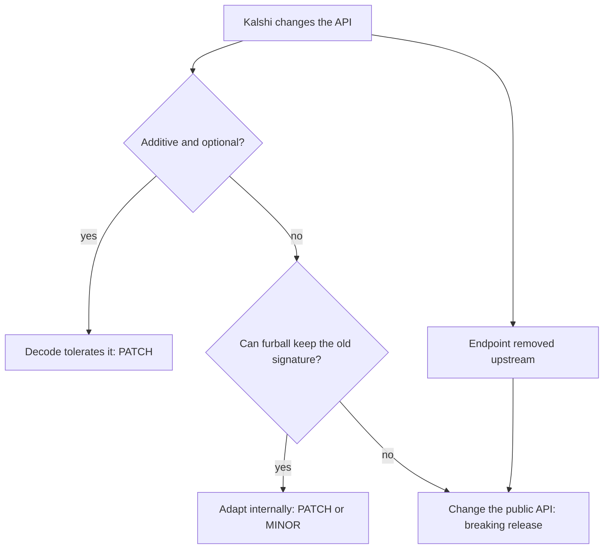

# Releasing

## Semver policy

Versions are `MAJOR.MINOR.PATCH`. While below 1.0.0, a breaking change bumps MINOR.

Breaking (bumps MAJOR, or MINOR below 1.0.0):

- Removing or renaming a public item, or changing a signature, field type or enum variant set
  (public enums and structs are exhaustive unless marked `#[non_exhaustive]`).
- Changing a default: environment, tier, retry count, rate-limit costs.
- Raising `rust-version`.
- Removing a cargo feature or making a feature enable more behavior that can send requests.

Not breaking (MINOR or PATCH):

- Adding items, methods, optional fields on request builders, or new cargo features.
- Fixing behavior to match Kalshi's documented API.
- Changing fee coefficient defaults to match Kalshi's published schedule.

### Kalshi API changes

Every change that tracks an upstream API change is listed in `CHANGELOG.md` under the Kalshi
change it follows.

## Release checklist

The maintainer publishes the crate; CI never has a crates.io token.

1. `git switch main && git pull`, with a clean working tree.
2. `./scripts/check.sh` passes.
3. `cargo test --all-features -- --ignored` passes against the demo environment with demo credentials.
4. Verify the fee coefficients against <https://kalshi.com/fee-schedule> in a browser and update
   `FeeCoefficients::default` if they differ.
5. Set the new `version` in `Cargo.toml`; move `[Unreleased]` entries in `CHANGELOG.md` under a
   dated version heading and add a fresh empty `[Unreleased]`.
6. `cargo publish --dry-run`, then inspect `cargo package --list`.
7. Commit `chore(release): vX.Y.Z`, open a PR, wait for CI, merge (never squash).
8. `git tag vX.Y.Z && git push origin vX.Y.Z`.
9. `cargo publish`.
10. Confirm the crate and its docs.rs build at <https://docs.rs/furball>.
